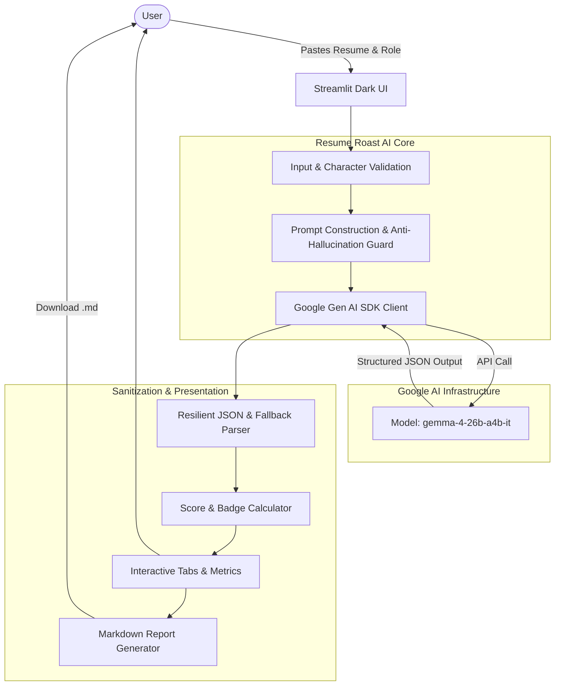

# 🔥 Resume Roast AI

> **A brutally honest, constructive resume critique engine powered by Google's Gemma 4 (`gemma-4-26b-a4b-it`).**  
> *Built for the MLH Open-Source AI Hackathon.*

[](https://opensource.org/licenses/Apache-2.0)
[](https://www.python.org/downloads/)
[](https://streamlit.io/)
[](https://github.com/googleapis/python-genai)
[](https://ai.google.dev/)

---

## 📌 Problem Statement

In today's ultra-competitive tech job market, over **75% of resumes are filtered out by Applicant Tracking Systems (ATS)** or discarded by recruiters within 6 seconds. Most candidates struggle with:
- **Vague, passive descriptions**: Listing duties like *"helped build website"* instead of quantifiable engineering outcomes.
- **Missing business impact**: Zero numbers, metrics, or scalability figures.
- **Keyword dumping**: Listing 30 technologies without demonstrating how they solved real-world problems.
- **Boring, generic feedback**: Traditional resume review services charge hundreds of dollars and take days to deliver generic, bland comments.

## 💡 Solution: Resume Roast AI

**Resume Roast AI** is a fast, fun, and brutally constructive web application that acts as a Principal Engineering Recruiter. It roasts resumes with witty, memorable humor while delivering actionable, high-impact improvements.

Powered by Google's cutting-edge open-weights Mixture-of-Experts (MoE) model **`gemma-4-26b-a4b-it`**, accessed via the official `google-genai` SDK, the app delivers a comprehensive 100-point audit, identifies red flags, provides before-and-after bullet point makeovers, and generates a prioritized 5-step roadmap.

---

## ✨ Key Features

- **🔥 Modern Dark-Themed UI:** Sleek obsidian dark background with glowing fiery orange (`#ff6b35`) and purple (`#a855f7`) accents, responsive cards, glassmorphism effects, and dynamic progress bars.
- **🧠 Real Google Gemma 4 Inference:** Strictly powered by `gemma-4-26b-a4b-it` (26B total / 4B active parameters MoE) accessed through Google's Gemini API endpoint via `from google import genai`.
- **📊 100-Point Scoring Engine:**
  - Overall composite score with grade badges (e.g., *Interview Magnet*, *Decent Foundation*, *Extra Crispy*).
  - 4 granular sub-scores:
    1. **Clarity & Structure (0–100%)**
    2. **Skills Relevance (0–100%)**
    3. **Project Descriptions (0–100%)**
    4. **Measurable Impact (0–100%)**
- **🥩 Brutally Honest Roast & Verdict:** Witty punchline burn paired with constructive, direct feedback explaining where the candidate stands.
- **⚠️ 3 Major Weaknesses Breakdown:** Pinpoints the top 3 red flags that cause recruiters and ATS filters to reject the resume.
- **✏️ 3 Bullet Point Makeovers:** Direct Before-and-After comparisons demonstrating how to rewrite weak lines into high-impact STAR-method bullets.
- **🎯 5 Prioritized Action Items:** A numbered checklist guiding the user on exactly what to fix first.
- **🛡️ Strict Anti-Fabrication Integrity:** The prompt strictly forbids inventing fake achievements, companies, or metrics. Missing values are flagged with clear placeholders (`[X%]`, `[metric]`, `[tool]`).
- **📋 One-Click Sample Resumes:** Evaluators can immediately test the app using built-in presets (*Weak Junior Dev*, *College Intern*) without searching for resume text.
- **📥 One-Click Markdown Export:** Download the entire roast report as a `.md` file for offline study or sharing.
- **🔒 Secure Credential Management:** Supports `.env`, Streamlit secrets, or session-only sidebar entry. API keys are never logged, stored, or exposed.
- **⚠️ Transparent AI Disclaimer:** Prominent notification clarifying that all feedback is an AI-generated educational estimate, not a hiring prediction.

---

## 🏗️ Architecture



---

## 🔬 Gemma 4 Integration Details

Resume Roast AI integrates with Google's latest open-weights model **`gemma-4-26b-a4b-it`** using the official Google Gen AI Python SDK (`google-genai`).

### Implementation Details:
1. **Model ID:** `gemma-4-26b-a4b-it` (Gemma 4 Mixture-of-Experts with 26B total and 4B active parameters).
2. **SDK Import:**
   ```python
   from google import genai
   ```
3. **Client Initialization & Inference:**
   ```python
   client = genai.Client(api_key=api_key)
   response = client.models.generate_content(
       model="gemma-4-26b-a4b-it",
       contents=prompt,
   )
   raw_text = response.text
   ```
4. **Key Configuration:**
   - Evaluated from `GEMINI_API_KEY` loaded via `python-dotenv`.
   - Alternative fallback to `st.secrets["GEMINI_API_KEY"]` for cloud deployments.
   - Fallback in-memory sidebar input for local testing.

---

## 🚀 Quickstart & Installation

Follow these steps to run **Resume Roast AI** locally on your machine.

### 1. Prerequisites
- **Python 3.10+** (Tested on Python 3.12)
- A **Gemini API Key** from [Google AI Studio](https://aistudio.google.com/app/apikey) (Free tier supported!)

### 2. Clone the Repository
```bash
git clone https://github.com/your-username/Resume_Roast_AI.git
cd Resume_Roast_AI
```

### 3. Set Up Virtual Environment
On Windows (PowerShell):
```powershell
python -m venv .venv
.\.venv\Scripts\Activate.ps1
```

On macOS / Linux:
```bash
python3 -m venv .venv
source .venv/bin/activate
```

### 4. Install Dependencies
```bash
pip install -r requirements.txt
```

### 5. Configure API Key
Create your `.env` file from the provided template:
```bash
cp .env.example .env
```
Open `.env` in any text editor and paste your API key:
```env
GEMINI_API_KEY=AIzaSyYourActualKeyHere...
```
*(Alternatively, you can skip editing `.env` and paste your key directly into the sidebar in the browser.)*

### 6. Launch the Web Application
```bash
streamlit run app.py
```
Streamlit will launch locally at:
👉 **`http://localhost:8501`**

---

## 🧪 Automated Testing

Resume Roast AI includes a comprehensive test suite in `tests/test_app.py` covering:
- Input validation (missing API keys, empty roles, short resumes, word count limits).
- Prompt construction and mandatory anti-hallucination integrity rules.
- Gemma response parsing (clean JSON, markdown-wrapped JSON, and safety fallbacks).
- Score badge assignments and flame-level rankings.
- Markdown report generation and disclaimer checks.

Run tests using pytest:
```bash
pytest -v
```

Output:
```text
============================= test session starts =============================
platform win32 -- Python 3.12.1, pytest-9.1.1
collected 18 items

tests/test_app.py::TestInputValidation::test_missing_api_key PASSED      [  5%]
tests/test_app.py::TestInputValidation::test_empty_role PASSED           [ 11%]
tests/test_app.py::TestInputValidation::test_whitespace_role PASSED      [ 16%]
tests/test_app.py::TestInputValidation::test_empty_resume PASSED         [ 22%]
tests/test_app.py::TestInputValidation::test_too_short_resume_characters PASSED [ 27%]
tests/test_app.py::TestInputValidation::test_too_few_words_resume PASSED [ 33%]
tests/test_app.py::TestInputValidation::test_valid_inputs_success PASSED [ 38%]
tests/test_app.py::TestPromptConstruction::test_prompt_contains_model_target_role PASSED [ 44%]
tests/test_app.py::TestPromptConstruction::test_prompt_forbids_hallucinated_metrics PASSED [ 50%]
tests/test_app.py::TestPromptConstruction::test_prompt_intensity_variations PASSED [ 55%]
tests/test_app.py::TestResponseParsing::test_parse_valid_clean_json PASSED [ 61%]
tests/test_app.py::TestResponseParsing::test_parse_markdown_fenced_json PASSED [ 66%]
tests/test_app.py::TestResponseParsing::test_parse_invalid_json_fallback PASSED [ 72%]
tests/test_app.py::TestScoreBadges::test_badge_high_score PASSED         [ 77%]
tests/test_app.py::TestScoreBadges::test_badge_medium_score PASSED       [ 83%]
tests/test_app.py::TestScoreBadges::test_badge_low_score PASSED          [ 88%]
tests/test_app.py::TestScoreBadges::test_badge_failing_score PASSED      [ 94%]
tests/test_app.py::TestMarkdownReportFormatting::test_report_contains_all_key_sections PASSED [100%]

============================= 18 passed in 3.15s ==============================
```

---

## 🎯 Demo & Usage Guide

1. **Select or Enter Target Role:** Default is `"Entry-Level Software Engineer"`, or click quick-select buttons (*Frontend Dev*, *Data / ML*), or type a custom role.
2. **Provide Resume Content:**
   - Paste your plain-text resume into the large text area, or
   - Click one of the sample buttons in the sidebar (**"Weak Junior"** or **"CS Intern"**) for an immediate one-click demo.
3. **Select Heat Level:** In the sidebar, choose between *Gentle Simmer*, *Medium Roast*, or *Extra Crispy*.
4. **Click "🔥 Roast My Resume":** Watch the loading indicator as Gemma 4 audits the resume.
5. **Explore Results:**
   - **Hero Score Box:** Overall score and grade.
   - **Metrics Grid:** Progress bars for Clarity, Skills, Projects, and Impact.
   - **Tab 1 (The Roast & Verdict):** Witty roast punchline and recruiter verdict.
   - **Tab 2 (3 Red Flags):** Critical weaknesses and ATS rejection reasons.
   - **Tab 3 (Bullet Makeovers):** Before vs. After STAR rewrites with metric placeholders.
   - **Tab 4 (5-Step Roadmap):** Prioritized actions to take immediately.
   - **Tab 5 (Export):** Download the full Markdown report.

---

## 🛡️ Ethical Considerations & Limitations

- **AI Estimate Notice:** The scores and evaluations provided by Resume Roast AI are simulated educational estimates generated by an AI model. They do not constitute official hiring predictions, certified ATS results, or employment guarantees.
- **Text-Only Input:** Complex multi-column graphic resumes should be pasted as plain text to ensure proper semantic ordering.
- **Human-in-the-Loop Integrity:** The system never fabricates accomplishments. When rewriting bullets, it provides metric templates (`[X%]`, `[saved Y hours]`) that require the user to provide authentic data from their real experience.

---

## 📁 Repository Structure

```text
Resume_Roast_AI/
├── .env.example            # Environment variables template
├── .gitignore              # Git ignore rules (secrets, venv, cache)
├── LICENSE                 # Apache License 2.0
├── README.md               # Comprehensive documentation
├── app.py                  # Main Streamlit web application & logic
├── pytest.ini              # Pytest configuration
├── requirements.txt        # Python package dependencies
└── tests/
    └── test_app.py         # Automated unit test suite (18 tests)
```

---

## 📄 License

This project is licensed under the **Apache License 2.0**. See the [LICENSE](file:///c:/Users/psatv/OneDrive/Pictures/Desktop/Resume_Roast_AI/LICENSE) file for details.

---

*Submitted to the MLH Open-Source AI Hackathon 2026. Powered by Google Gemma 4.*
